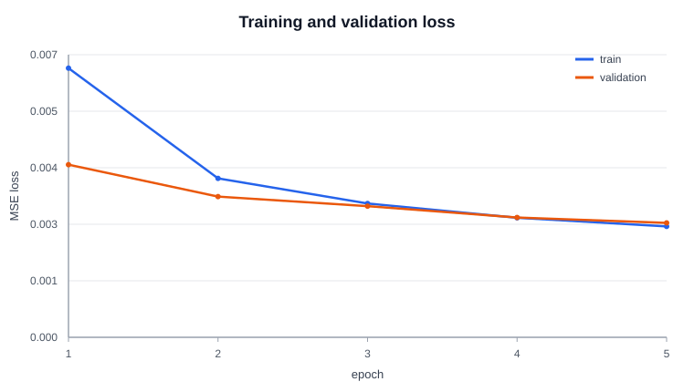
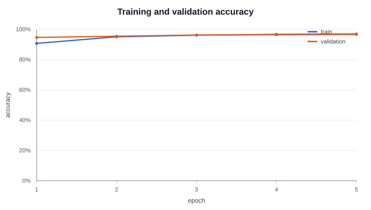
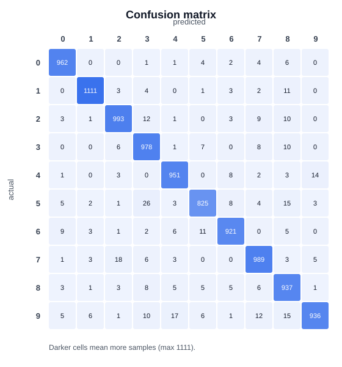

# Handwritten Digit Recognizer (C#)

A small neural network built from scratch in C# that recognizes handwritten
digits from MNIST. It uses no machine learning libraries, only the input,
hidden, and output neuron classes in this repository.

The network takes a 32×32 image (1,024 inputs), uses one hidden layer of 64
neurons, and outputs a score for each digit 0–9. It is trained with
backpropagation and mean squared error.

## Data

[MNIST](https://yann.lecun.com/exdb/mnist/) has 70,000 images of handwritten
digits (28×28 pixels, labels 0–9).

- 60,000 training images are split into **50,000 train / 10,000 validation**.
- The official **10,000 test images** are used once at the end.
- Images are padded to 32×32 and scaled from 0–255 to 0–1.

## Requirements

- [.NET 10 SDK](https://dotnet.microsoft.com/download)

## Run the GUI

From the same project root folder:

```powershell
dotnet run --project Gui
```

The GUI is a separate project, so it needs `--project Gui`. It loads
`weights/best.txt`, so run the trainer first. Draw a digit and press **Read**.

## Run the trainer

From the project root folder (the folder containing `Program.cs`):

```powershell
dotnet run
```

This is the console trainer. It runs 5 epochs with the tuned settings and saves
`weights/best.txt`, per-epoch weights, and CSV/SVG logs in `logs/`.

Other options:

```powershell
dotnet run -- --hidden 128 --lr 0.15 --hidden-lr 0.12 --epochs 8 --seed 42
dotnet run -- --help
```

| Option | Default | Meaning |
| --- | --- | --- |
| `--hidden <n>` | 64 | Number of hidden neurons |
| `--lr <x>` | 0.3 | Output-layer learning rate |
| `--hidden-lr <x>` | 0.2 | Hidden-layer learning rate |
| `--epochs <n>` | 5 | Number of training passes |
| `--seed <n>` | 1234 | Seed for the data split and weight initialization |

`--help` also lists the flags used for tuning on smaller subsets.

## Tuning

`scripts/tune.ps1` tries several settings and writes the results to
`logs/experiments.csv`.

```powershell
powershell -ExecutionPolicy Bypass -File scripts/tune.ps1
```

| Hidden | Output lr | Hidden lr | Epochs | Best val accuracy |
| ---: | ---: | ---: | ---: | ---: |
| 32 | 0.10 | 0.10 | 2 | 88.0% |
| 64 | 0.10 | 0.10 | 2 | 89.6% |
| 64 | 0.30 | 0.20 | 2 | **90.8%** |
| 64 | 0.20 | 0.15 | 4 | 92.0% |
| 128 | 0.20 | 0.15 | 2 | 90.6% |

The best setup was 64 hidden neurons with learning rates 0.3 and 0.2. A larger
hidden layer did not help and was slower.

## Results

Final settings: **64 hidden neurons, lr 0.3, hidden-lr 0.2, seed 1234, 5 epochs**.

| Epoch | Train loss | Train accuracy | Val loss | Val accuracy |
| ---: | ---: | ---: | ---: | ---: |
| 1 | 0.0064 | 90.71% | 0.0041 | 94.62% |
| 2 | 0.0038 | 95.05% | 0.0034 | 95.45% |
| 3 | 0.0032 | 96.09% | 0.0031 | 96.21% |
| 4 | 0.0029 | 96.67% | 0.0029 | 96.40% |
| 5 | **0.0026** | **96.92%** | **0.0027** | **96.65%** |

Loss decreased every epoch. On the test set, the model gets **96.03% accuracy**
with an average F1 score of **0.960**.







Full logs and tuning results are in `logs/`.

## Files

| Path | Purpose |
| --- | --- |
| `Program.cs` | Training loop, data split, evaluation, logging |
| `NeuralNetwork.cs`, `*Neuron.cs` | The network |
| `DatasetLoader.cs`, `DigitNormalizer.cs` | Data loading and image preparation |
| `Metrics.cs`, `ChartWriter.cs` | Metrics and SVG charts |
| `TrainingConfig.cs`, `scripts/tune.ps1` | Settings and tuning |
| `Gui/` | Drawing app |
| `data/`, `weights/`, `logs/` | Data, saved models, results |
